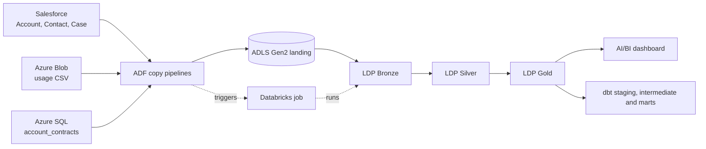
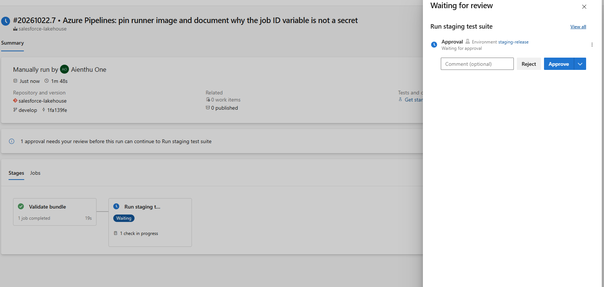
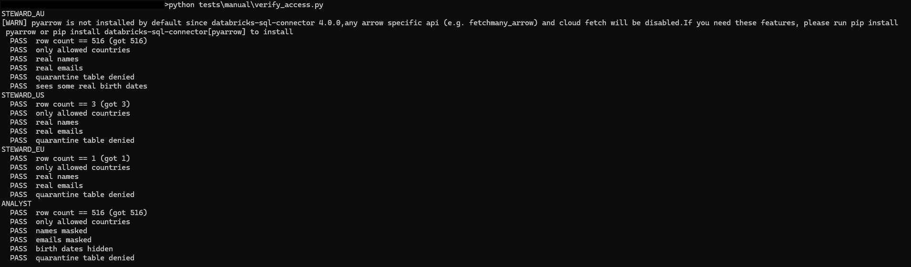
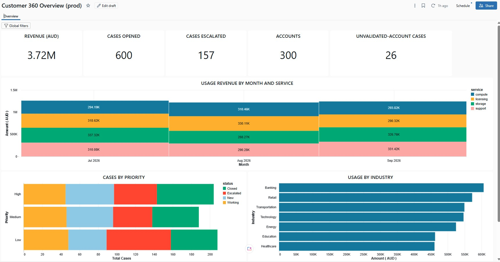

# Salesforce Customer 360 Lakehouse

A multi-source customer 360 lakehouse on Azure and Databricks. Azure Data Factory (ADF) copies data from Salesforce, Azure SQL and Azure Blob Storage into an ADLS Gen2 landing zone. Lakeflow Declarative Pipelines (LDP) then build Bronze, Silver and Gold layers on Unity Catalog, and a Databricks AI/BI dashboard sits on the Gold layer. Infrastructure is Terraform, deployment is Databricks Asset Bundles (DABs), and promotion is gated by tests in GitHub Actions plus an approval check in Azure DevOps.

> Contributions are not open at this time.

## What it does

- **Three sources, one landing zone:** ADF copies Salesforce Account, Contact and Case objects, a usage CSV from Blob Storage, and an `account_contracts` table from Azure SQL into the landing container. A master pipeline then triggers the Databricks job once all the copies finish.
- **Medallion layers:** Bronze ingests the landed files with Auto Loader. Silver applies per-entity quality rules, sends failing rows to quarantine tables, and keeps current state with auto CDC (SCD Type 1). Gold builds dimensions, facts and aggregates. Bronze and Silver tables are defined from registries (`registry.py`), so adding an entity is a registry entry.
- **Contract enrichment:** Azure SQL contract data adds a `contract_tier` to the account dimension and feeds a separate committed-versus-actual usage table.
- **Dashboard:** a Databricks AI/BI dashboard, deployed through DABs and parameterised per environment.

## Architecture

## Data

All data is synthetic. A seeded generator in `data_generator/` creates the Salesforce records (300 Accounts, 500 Contacts, 600 Cases in a Salesforce Developer Edition org), the usage file, and the contract rows loaded into Azure SQL. Names, emails, phone numbers and bank names are localised for Australia. No real customer data is used.

## Repository layout

| Path | Contents |
|---|---|
| `adf/` | Exported ADF factory: datasets, linked services and copy pipelines (Git-integrated on `develop`) |
| `ldp_pipelines/` | LDP pipeline code for Bronze, Silver and Gold |
| `utils/` | Pure transform functions used by the pipelines and unit tests |
| `resources/`, `databricks.yml` | Asset Bundle config: the pipeline, the dashboard and the test-suite job |
| `src/` | Dashboard definition (`customer_360.lvdash.json`) |
| `infra/terraform/` | Azure infrastructure: Databricks storage credential and Unity Catalog, ADF, source storage, Azure SQL |
| `data_generator/` | Synthetic data generator and the Azure SQL loader |
| `sql/` | Azure SQL setup scripts and a job-health query over system tables |
| `tests/` | `unit`, `integration` and `e2e` tiers |
| `sf_dbt/` | dbt Core project over Gold: staging, intermediate, marts, tests, a demo snapshot and SCD2 scenarios (`sf_dbt/scenarios/scd2/`) |
| `sf_dbt/ci/` | CI profile, one-time grants notebook and README. The schema-cleanup macros live in `sf_dbt/macros/` |
| `docs/` | Cloud requirements and dashboard snapshots |
| `.github/` | Workflows for each gate, and exported branch rulesets |
| `governance/` | Mask and row-filter functions, and the grants applied after each pipeline run |
| `azure-pipelines.yml` | Manual release check with an approval gate (Azure DevOps) |
| `tests/manual/` | Per-group access check, run by hand |

## Environments and promotion gates

Work moves `develop` → `staging` → `main`. The bundle has `dev`, `staging` and `prod` targets, each with its own Unity Catalog catalog, in one workspace.

| Event | Gate | What runs |
|---|---|---|
| Push to `develop` | Unit tests | Transform and registry tests |
| Pull request into `staging` | Integration test and `dbt-build` | Gold row counts and revenue totals reconcile with Silver; `dbt build` runs the models, seed, snapshot, 58 data tests and 1 unit test in an isolated schema |
| Pull request into `main` | End-to-end test | The Gold tables behind the dashboard's headline numbers match known values (300 accounts, 600 cases, 3,721,662.94 revenue) |

Rulesets (exported in `.github/rulesets/`) require pull requests, merge commits only and the integration and `dbt-build` checks on `staging` and the e2e check on `main`, with no bypass actors. Direct pushes to those branches are rejected, including for the owner. `develop` only blocks deletion and force-pushes, because ADF Studio commits to it directly.

**Azure DevOps release check.** `azure-pipelines.yml` is a manually triggered pipeline: it validates the bundle against staging, waits for an approval on the `staging-release` environment, then runs the staging test suite. It authenticates with an Entra token from a service connection, and the pipeline's service principal has `CAN_MANAGE_RUN` on the staging test job only.

## Governance

Column masks and a row filter protect `silver.contact`, defined as SQL functions in `governance/01_mask_functions.py` and attached through the Silver registry schema.

- **Column masks:** `mask_text`, `mask_email` and `mask_date` cover 8 contact fields (names, email, phones, mailing city, birth date). Members of `pii_readers` see real values; everyone else sees `***`, a masked email or null.
- **Row filter:** `region_filter` limits contacts by `mailing_country` for the groups `global_reader`, `steward_au`, `steward_us`, `steward_eu` and `analyst`. `global_reader` sees all rows, `steward_au` and `analyst` see Australia, `steward_us` sees the US, and `steward_eu` sees France.
- **Grants:** `governance/02_grants.py` runs after the pipeline and gives those five groups read access to `silver.contact` only. The quarantine tables are not granted.
- **Tests:** integration and e2e tests check that the masks and the filter are attached in each catalog. `tests/manual/verify_access.py` checks behaviour per group (row counts, masked or real values, quarantine denied); it is run by hand and not in CI.

## Dashboard

The dashboard shows revenue, cases opened and escalated, and account counts, with usage revenue by month and service, cases by priority and status, and usage by industry. Full PDF: [`Customer 360 Overview.pdf`](docs/dashboards/Customer%20360%20Overview.pdf)

## dbt layer

A dbt Core project (`sf_dbt/`) consumes the Gold layer and adds staging views, intermediate models (including an incremental usage model), two marts with enforced contracts, reusable macros, a demo snapshot and a dashboard exposure. It has 11 models, 58 data tests and 1 unit test, descriptions are persisted to Unity Catalog, and it runs as its own least-privilege service principal that can read Gold and write only to its own schema (Gold write denial tested). It has one documented warning (see Trade-offs and known gaps). See [sf_dbt/README.md](sf_dbt/README.md).

**CI gate.** Pull requests into `staging` run `dbt build` as a required check after the integration tests. Each run starts and ends with an empty `dbt_staging` schema, and an assert step fails the job if cleanup leaves anything behind. The service principal, its schema and the warehouse permission were created by hand, and its grants are applied by a manual, recorded notebook (`sf_dbt/ci/`), with Terraform planned.

## Design decisions

- **ADF for extraction, Databricks for transformation.** Three different source types is the reason ADF is here. A single source would go straight into Databricks.
- **No secrets in git.** Salesforce is reached through an External Client App using the client credentials flow, and the client secret lives in Key Vault. Azure SQL is reached with Entra tokens and a managed identity user, with no passwords.
- **Current contract, one row per account.** Silver contracts are SCD Type 1 keyed on contract, and Gold selects each account's current contract with `ROW_NUMBER`. A separate Gold table holds committed-versus-actual usage, so the validated headline numbers stay stable.

## Engineering notes

1. **A join fan-out inflated the numbers.** Five accounts have two contract rows after a renewal. A naive join took `dim_account` from 301 rows to 306 and revenue from 3,721,662.94 to 3,771,008.68, and the e2e test failed. Selecting the current contract per account restored 301 rows and the original revenue. A one-row-per-account test now guards the grain.
2. **A serverless SQL warehouse cost spike.** A Small warehouse with a 10-minute auto-stop left an idle tail that drove up cost. It is now 2X-Small with a 5-minute auto-stop.
3. **A gate that must be able to fail.** To prove the dbt check blocks bad changes, a deliberately broken test was pushed on a throwaway branch (PR #17): the check went red, the merge was blocked, and cleanup still ran. The PR was closed without merging.

## Trade-offs and known gaps

**Solo-build trade-offs**
- One landing zone for all environments. The workspace and storage account are shared with my [TfNSW lakehouse project](https://github.com/AiEnthu2026/tfnsw-transit-lakehouse), with a separate container, access connector and catalogs.
- Three CI identities: a personal access token for the bundle deploys, a dedicated OAuth service principal for the dbt gate (shared by dev and staging), and an Entra token from a service connection for the Azure DevOps check.
- No required reviewers between stages. dbt doesn't run on `main` promotions, which run the e2e suite.
- The workspace host and storage account name are committed on purpose. They are identifiers, not credentials, and a hardcoded host stops a misconfigured CI variable from redirecting a deploy.

**Known gaps**
- The Network Security Perimeter is in learning mode, and the Key Vault, the dbt service principal's grants and its schemas were created by hand, not in Terraform.
- Contracts are SCD Type 1 in the pipeline. SCD Type 2 is shown only on demo data (four manual scenarios, not in CI), and incremental loads of changed contracts are untested.
- Revenue band is `Unknown` for every account because the generator sets no annual revenue.
- 13 Developer Edition sample accounts fail the `customer_ref` rule and sit in quarantine. 20 contacts reference 12 of them, so `dim_contact` keeps their raw account ID while the fact tables map them to UNKNOWN. `sf_dbt` flags and maps them (its relationships test warns on the 20 orphan contacts), and the pipeline fix is planned.
- 26 cases also map to UNKNOWN, probably from the same sample records, not yet confirmed.

## Data and trademarks

This is a personal learning project using synthetic data. It is not affiliated with or endorsed by Salesforce, Microsoft or Databricks. All trademarks belong to their owners.