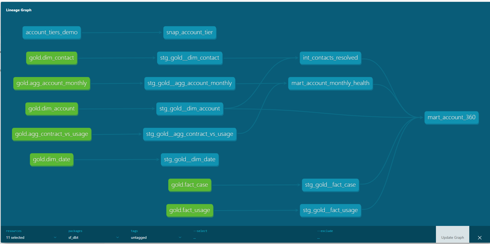

# sf_dbt

   A dbt Core project over the Gold layer of this repository. It reads the seven Gold tables and builds staging views, one intermediate model and two marts on top of them, with tests on keys, relationships, allowed values and reconciliation. It never writes to Gold.



*Lineage with tests hidden: 7 Gold sources feed 7 staging views, then an intermediate model and two marts. The seed and snapshot at the top are a separate demo on controlled data.*

## Status
The dbt layer is complete: staging, one intermediate model, two marts, a reusable macro, a demo snapshot and logic tests.

## What is in it
- 7 sources (the Gold tables) and 7 staging views
- 1 intermediate model, `int_contacts_resolved`, which maps orphan contacts to the UNKNOWN account and flags them
- 2 marts: `mart_account_monthly_health` (one row per account and month) and `mart_account_360` (one row per account)
- 1 reusable macro, `safe_divide`, with a logic test, plus a write-probe macro used to test permissions
- 1 seed and 1 snapshot (SCD Type 2), demonstrated on controlled demo data because the Gold data does not change
- 50 data tests: 29 on staging, 5 on the intermediate model, 8 on the first mart, 7 on the second mart, 1 on the macro
- Last full run: 61 passed, 1 warning, 0 errors (10 models, 50 tests, 1 seed, 1 snapshot)

## Identity and access
dbt runs as its own Databricks service principal, not as a person and not with the shared token. It can read the Gold schema and create and write tables in `dbt_dev`. No credentials are stored in this repository.
Tested: creating a table in the Gold schema as this service principal fails with PERMISSION_DENIED, while the same operation succeeds in `dbt_dev`.

## Run it
You need Python, a virtual environment with `requirements-dbt.txt` installed, a `profiles.yml` outside the repository, and these environment variables set in the same shell (names only):

- DBT_DATABRICKS_HOST
- DBT_HTTP_PATH
- DBT_CATALOG
- DBT_DATABRICKS_CLIENT_ID
- DBT_DATABRICKS_CLIENT_SECRET

The profile reads every value through `env_var`, so it holds no secrets:

```
sf_dbt:
  target: dev
  outputs:
    dev:
      type: databricks
      host: "{{ env_var('DBT_DATABRICKS_HOST') }}"
      http_path: "{{ env_var('DBT_HTTP_PATH') }}"
      catalog: "{{ env_var('DBT_CATALOG') }}"
      schema: dbt_dev
      auth_type: oauth
      client_id: "{{ env_var('DBT_DATABRICKS_CLIENT_ID') }}"
      client_secret: "{{ env_var('DBT_DATABRICKS_CLIENT_SECRET') }}"
      threads: 4
```

Then, from the `sf_dbt` folder:

```
dbt debug
dbt build -t dev
dbt docs generate
```

For permission test, run the following from `sf_dbt` folder. The first run in `dbt_dev` should succeed and the probe table is then dropped. The run against `gold` must fail with PERMISSION_DENIED.

```
dbt run-operation write_probe --args "{schema_name: dbt_dev}"
dbt run-operation drop_probe --args "{schema_name: dbt_dev}"
dbt run-operation write_probe --args "{schema_name: gold}"
```

## Design choices
- **dbt consumes Gold and does not rebuild it.** The pipeline owns ingestion through Gold. Tests guard keys, relationships and allowed values, and mart_account_360 reconciles to its sources. They do not verify that business definitions such as the utilisation bands are right.
- **Staging models are views with explicit column lists.** A new Gold column does not flow through silently, and each model documents what dbt depends on.
- **The aggregate tables get a built key.** `account_month_key` joins account and month so one unique test covers both columns, with not_null tests on the two source columns.
- **Separate write schema.** dbt writes only to `dbt_dev`, so a bad run cannot overwrite pipeline output.
- **Marts use `ref()`,** so lineage runs source, staging, intermediate, marts.
- **`mart_account_360` aggregates contacts, cases and usage to account grain before joining,** so the joins cannot fan out. A test reconciles its totals to `dim_account`, `fact_usage`, `fact_case` and `int_contacts_resolved`.
- **`commit_status` thresholds are project variables** (`util_under_pct`, `util_over_pct`). They are illustrative, not business rules.
- **Month-over-month change is null when the previous month is missing.** The data covers three months (July to September 2026), so the rolling average spans at most three points.
- **The snapshot uses the timestamp strategy,** so a change only registers if `updated_at` moves forward.

## Known issues
- 20 contacts reference 12 account IDs that are not in `dim_account`. `int_contacts_resolved` maps them to UNKNOWN and flags them. The warning on `stg_gold__dim_contact` stays to document the upstream difference, and the pipeline fix is on the backlog.
- Tables created by dbt are owned by its service principal, so reading them as a person needs an explicit grant on `dbt_dev`.
- The SCD2 snapshot is a demonstration on controlled seed data, not on pipeline data.
- "Staging" here means the model layer, not the staging environment.
- The service principal, the `dbt_dev` schema and the warehouse permission were created by hand, not in Terraform.
- CI does not run dbt yet.
- The snapshot demo cannot be reproduced from a fresh clone, because the committed seed is the changed version. To replay it, check out the "add demo seed and tier snapshot" commit, run dbt seed and dbt snapshot, then check out the later commit and run them again
- stg_gold__dim_date has no downstream model yet.