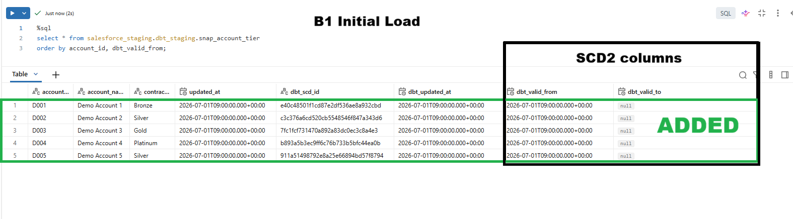
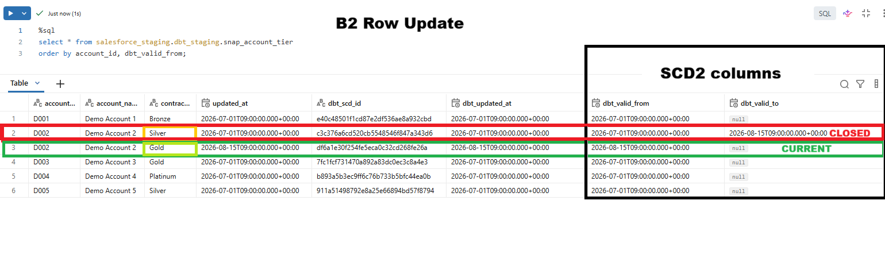
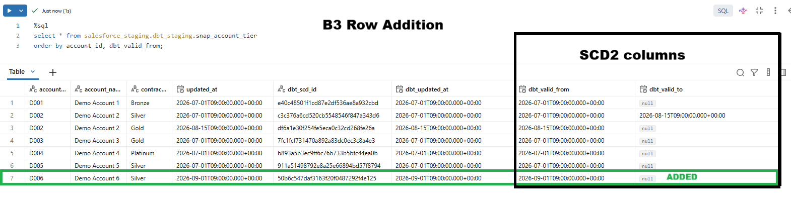
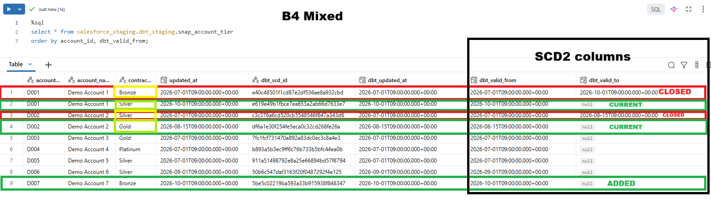

# SCD2 scenarios

Four scenarios that check how the `snap_account_tier` snapshot records history. The snapshot reads the `account_tiers_demo` seed, uses `account_id` as the key and the timestamp strategy on `updated_at`.

These scenarios are run by hand against the staging catalog. They are not part of `dbt build` or the CI gate.

## Files

| File | What changes compared with the previous step |
|---|---|
| `b1_initial_load.csv` | Five accounts (D001 to D005), all new |
| `b2_row_update.csv` | D002 moves from Silver to Gold, with a later `updated_at` |
| `b3_row_addition.csv` | D006 is added, and everything else is unchanged |
| `b4_mixed.csv` | D001 moves from Bronze to Silver and D007 is added, in one run |

The files are kept outside `seeds/`, so `dbt build` never loads them.

## How to run

1. Start with an empty `dbt_staging` schema (`dbt run-operation clean_target_schema`, then `dbt run-operation assert_schema_empty`).
2. For each file, in order b1 to b4, from the `sf_dbt` folder:
   - copy `scenarios\scd2\<file>` over `seeds\account_tiers_demo.csv`
   - `dbt seed --select account_tiers_demo --full-refresh`
   - `dbt snapshot --select snap_account_tier`
   - query the result:
      ```sql
         select * from salesforce_staging.dbt_staging.snap_account_tier
         order by account_id, dbt_valid_from;
      ```
3. Do not clean between steps. The snapshot's history is what is being tested.
4. At the end, restore the seed (`git checkout -- seeds\account_tiers_demo.csv`), then clean and assert the schema is empty.

## Results

Run on 15 October 2026. Every step matched the expected counts.

| Step | Expected total rows | Expected current rows | Result |
|---|---|---|---|
| b1 initial load | 5 | 5 | matched |
| b2 row update | 6 | 5 | matched |
| b3 row addition | 7 | 6 | matched |
| b4 mixed | 9 | 7 | matched |

A row is current when `dbt_valid_to` is null.

**b1: initial load.** All five rows are new and current.



**b2: row update.** D002's Silver version is closed on 2026-08-15 and its Gold version is current.



**b3: row addition.** D006 is added as one current row. Nothing else changes.



**b4: mixed.** D001's Bronze version is closed on 2026-10-01 and its Silver version is current. D007 is added. D002 keeps its closed and current rows from b2.



## What it shows

- A changed row closes the old version and opens a new one. The closed row's `dbt_valid_to` equals the new row's `dbt_valid_from`, with no gap and no overlap.
- Rows that did not change are left alone.
- A new key opens a single current row.
- Versions are dated by the source `updated_at`, not by the time the snapshot ran.

## Notes

- Each screenshot highlights only the changes made in that step. Rows closed in an earlier step are not marked again.
- Unannotated screenshots (`*_raw.png`) are in the same folder, `docs/dbt/scd2/`.
- dbt owns the tables it creates, so reading `dbt_staging` as a person needs `SELECT` on the schema.

## Not covered

- Rows deleted from the source. The snapshot does not invalidate hard deletes.
- Runs where `updated_at` does not move forward. With the timestamp strategy, such a change is not recorded.
- Automation. This is a manual check; a scripted version in CI is a possible later step.